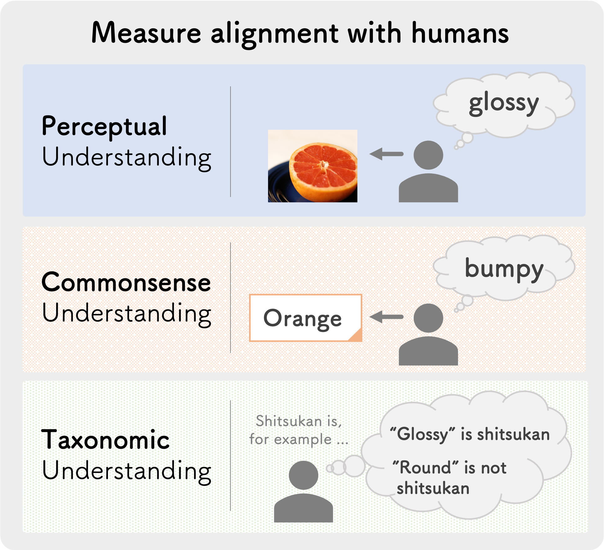

<div align="center">

shitsukan-eval
===========================
<h3>人間の知覚とモデル（LLM / LVLM）の整合性評価</h3>

[📄 論文](https://aclanthology.org/2025.coling-main.757/) &nbsp;&nbsp;|&nbsp;&nbsp; [🤗 データセット](https://huggingface.co/datasets/tohoku-nlp/Shitsukan) &nbsp;&nbsp;|&nbsp;&nbsp; [🇬🇧 English](README.md)



<div align="left">

<br>

本リポジトリでは、日本語の「質感（*shitsukan*）」という概念に着目し、大規模言語モデル（LLM）および大規模視覚言語モデル（LVLM）が人間の知覚とどの程度整合しているかを評価します。  
質感とは、物体を知覚したときに得られる感覚的な体験を表すもので、本質的に曖昧で主観性の高い概念です。  
私たちは、指定された物体の画像を見た人が想起した質感語からなる新しいデータセットを構築しました。また、LLM と LVLM の質感認識能力を評価するためのベンチマークタスクを設計しました。

<br>

このライブラリは実験的なもので、現在も開発中です。
使いやすさと性能を改善するため、今後 **後方互換性のない変更** を加える予定です。

# 目次

- [対応モデル](#対応モデル)
- [使い方](#使い方)
  - [1. 環境構築](#1-環境構築)
  - [2. データの準備](#2-データの準備)
  - [3. 評価の実行](#3-評価の実行)
  - [4. 出力](#4-出力)
- [再現性に関する注意](#再現性に関する注意)
- [開発](#開発)
- [引用](#引用)
- [謝辞](#謝辞)

## 対応モデル

<details>
<summary><b>現在対応している API の LLM / LVLM は以下のとおりです。</b></summary>
<li><a href="https://platform.openai.com/docs/models/gpt-4o">GPT-4o</a></li>
<li>（🚧 ここに本リポジトリの説明を追加予定 🚧）</li>
</details>

<br>

<details>
<summary><b>現在対応している Hugging Face の LLM は以下のとおりです。</b></summary>
<li><a href="https://arxiv.org/abs/2307.09288">Llama 2</a></li>
<li><a href="https://note.com/elyza/n/na405acaca130">ELYZA-japanese-Llama-2</a></li>
<li><a href="https://arxiv.org/abs/2407.10671">Qwen 2</a></li>
<li><a href="https://arxiv.org/abs/2407.21783">Llama 3</a></li>
<li><a href="https://swallow-llm.github.io/llama3-swallow.ja.html">Llama-3-Swallow</a></li>
<li><a href="https://arxiv.org/abs/2408.00118">Gemma 2</a></li>
<li><a href="https://qwen2.org/qwen2-5/">Qwen 2.5</a></li>
<li><a href="https://llmc.nii.ac.jp/topics/post-707/">LLM-jp-3</a></li>
<li>（🚧 ここに本リポジトリの説明を追加予定 🚧）</li>
</details>

<br>

<details>
<summary><b>現在対応している Hugging Face の LVLM は以下のとおりです。</b></summary>
<li><a href="https://arxiv.org/abs/2310.03744">LLaVA-1.5</a></li>
<li><a href="https://arxiv.org/abs/2405.02246">Idefics2</a></li>
<li><a href="https://llava-vl.github.io/blog/2024-01-30-llava-next/">LLaVA-NeXT (LLaVA-1.6)</a></li>
<li><a href="https://arxiv.org/abs/2407.21783">Llama-3.2-Vision</a></li>
<li><a href="https://arxiv.org/abs/2408.03326">LLaVA-OneVision</a></li>
<li><a href="https://www.arxiv.org/abs/2408.12637">Idefics3</a></li>
<li><a href="https://arxiv.org/abs/2409.12191">Qwen2-VL</a></li>
<li><a href="https://www.arxiv.org/abs/2409.17146">Molmo</a></li>
<li>（🚧 ここに本リポジトリの説明を追加予定 🚧）</li>
</details>

<br>

<details>
<summary><b>現在対応している vLLM の LLM は以下のとおりです。</b></summary>
<li>（🚧 ここに本リポジトリの説明を追加予定 🚧）</li>
</details>

<br>

<details>
<summary><b>現在対応している vLLM の LVLM は以下のとおりです。</b></summary>
<li><a href="https://arxiv.org/abs/2409.12191">Qwen2-VL</a></li>
<li>（🚧 ここに本リポジトリの説明を追加予定 🚧）</li>
</details>

<br>

<details>
<summary><b>モデル名と使用されるラッパーの対応</b></summary>

使用するラッパーは、`--model` の値を小文字にした文字列に含まれる部分文字列で決まります。上から順に判定し、最初に一致した規則が使われます。

| `--model-type` | モデル名に含まれる部分文字列 | ラッパー |
|---|---|---|
| `hf` | `llama-3.2` と `vision`（さらに `instruct`） | Llama-3.2-Vision（`MllamaInstructHf`） |
| `hf` | `llava` と `1.5` / `next` または `1.6` / `onevision` | LLaVA-1.5 / LLaVA-NeXT / LLaVA-OneVision |
| `hf` | `idefics2` / `idefics3` / `qwen2-vl` / `molmo` | Idefics2 / Idefics3 / Qwen2-VL / Molmo |
| `hf` | `llama-3`（さらに `instruct`） | Llama 3（Llama-3-Swallow を含む） |
| `hf` | `llama-2`（さらに `chat` または `instruct`） | Llama 2（ELYZA-japanese-Llama-2 を含む） |
| `hf` | `gemma-2` | Gemma 2 |
| `hf` | `qwen2.5` / `qwen2`（さらに `instruct`） | Qwen 2.5 / Qwen 2 |
| `hf` | `llm-jp-3`（さらに `instruct`） | LLM-jp-3 |
| `vllm` | `qwen2-vl` | Qwen2-VL |
| `api` | `gpt-4` | GPT-4o などの GPT-4 系モデル |

これ以外のモデル名はエラーになります。
</details>

## 使い方

タスクとモデルの設定ファイルは相対パスで読み込まれるため、すべてのコマンドはリポジトリのルートで実行してください。

### 1. 環境構築

```bash
cd $HOME
git clone https://github.com/cl-tohoku/shitsukan-eval.git
cd $HOME/shitsukan-eval
uv python install 3.11
uv python pin 3.11
uv sync --no-dev
uv sync --dev --no-build-isolation
```

2 回目の `uv sync` では開発用ツールもインストールされます。Linux x86_64 では `flash-attn` も含まれ、ビルド分離なしでビルドされるため、先に PyTorch がインストールされている必要があります。

OpenAI のモデルを評価する場合は、API キーを設定してください。

```bash
export OPENAI_API_KEY="<your_api_key>"
```

### 2. データの準備

```bash
# COCO 2017 の画像を <image_dir>/images/coco/{train2017,val2017} に配置する
mkdir -p $HOME/data/images/coco
cd $HOME/data/images/coco
wget http://images.cocodataset.org/zips/train2017.zip
wget http://images.cocodataset.org/zips/val2017.zip
unzip -q train2017.zip
unzip -q val2017.zip

# Shitsukan データセットを取得し、その data ディレクトリを ./data にリンクする
cd $HOME
git lfs install
git clone https://huggingface.co/datasets/tohoku-nlp/Shitsukan
ln -s $HOME/Shitsukan/data $HOME/shitsukan-eval/data
```

タスクの設定ファイルは、データセットのファイルが `./data` 以下にあることを前提としています（例: `data/perception/selection/choice2_ans1/perception_selection_choice2-ans1_ja.jsonl`）。
データセット内の画像パス（例: `images/coco/train2017/000000000071.jpg`）は `--image-dir` からの相対パスとして解決されるため、上記の配置では `--image-dir $HOME/data` を指定してください。

### 3. 評価の実行

次のコマンドで、指定したモデルを shitsukan-eval の指定したタスクで評価します。

```bash
export CUDA_VISIBLE_DEVICES=0
uv run python -m shitsukan_eval \
    --model "<model_name_or_path>" \
    --model-type "<model_type>" \
    --tasks "<task_name>" \
    --sub-tasks "<sub-task_name>" \
    --lang "<lang>" \
    --image-dir "<base-image_path>" \
    --save-dir outputs \
    --verbose
```

<details>
<summary><b>指定できる引数の説明</b></summary>

- `--model`（`str`、必須）: 評価するモデルの名前またはパス（例: `"Qwen/Qwen2-VL-7B-Instruct"`）
- `--model-type`（`str`、必須）: 指定したモデルの種類
  - 指定できる値: `"api"`, `"hf"`, `"vllm"`
- `--tasks`（`List[str]`、必須）: 評価するタスク
  - 指定できる値: `"perception"`, `"commonsense"`, `"taxonomic"`
- `--sub-tasks`（`List[str]`、必須）: 評価するサブタスク。すべてのタスクに対してすべてのサブタスクを実行するため、どの組み合わせも対応している必要があります。
  - `--tasks "perception" --lang "ja"` の場合に指定できるサブタスク: `"generation"`, `"selection"`
  - `--tasks "perception" --lang "en"` の場合に指定できるサブタスク: `"selection"`
  - `--tasks "commonsense" --lang "ja"` の場合に指定できるサブタスク: `"generation"`, `"classification"`
  - `--tasks "commonsense" --lang "en"` の場合に指定できるサブタスク: `"classification"`
  - `--tasks "taxonomic" --lang "ja"` の場合に指定できるサブタスク: `"a_b_classification"`, `"yes_no_classification"`, `"multiple_choice_classification"`
  - `--tasks "taxonomic" --lang "en"` の場合: 指定できるサブタスクはありません
- `--lang`（`str`、必須）: 評価に用いる言語
  - 指定できる値: `"ja"`, `"en"`
- `--image-dir`（`Optional[str]`）: データセットの画像パスを解決する基準ディレクトリ（任意）
  - `--image-dir "$HOME/data"` を指定すると、COCO 2017 の画像を `$HOME/data/images/coco/train2017/*.jpg` と `$HOME/data/images/coco/val2017/*.jpg` から読み込みます。COCO 2017 の画像を用意していない場合は、事前に[こちら](https://cocodataset.org/#download)からダウンロードしてください。
  - perception タスクで LVLM（GPT-4o を含む）を評価する場合は必須です。
- `-s`, `--save-dir`（`str`、必須）: 評価結果を保存するディレクトリ
- `-v`, `--verbose`（`bool`）: 指定すると、処理中に各プロンプトとモデルの回答を表示します。

</details>

<br>

> [!NOTE]
> 各タスクの設定ファイルは `shitsukan_eval/tasks/{task}/{sub_task}/{task}_{sub_task}_{lang}.yaml` に、モデルの既定の設定は `models/hf_models/hf_model_default_config.yaml` と `models/vllm_models/vllm_model_default_config.yaml` にあります。<br>設定を変更したい場合は、これらのファイルを編集してください。

> [!NOTE]
> Molmo を評価する場合は、GPU を 1 枚だけ見えるようにしてください（例: `CUDA_VISIBLE_DEVICES=0`）。

### 4. 出力

タスクとサブタスクごとに、プロンプトとモデルの応答を含むレコードが `<save_dir>/<task>/<sub_task>/<task>_<sub_task>_<lang>_<model_type>_<model>.jsonl` に保存されます。`<model>` は `--model` の最後のパス要素です。
分類タスクと選択タスクは、スコアを同じディレクトリの `<task>_<sub_task>_<lang>_<model_type>_<model>_scores.jsonl` にも保存し、標準出力に表示します。
サブセットを持つタスク（perception の selection と taxonomic の multiple_choice_classification）は、各サブセットのレコードを `<save_dir>/<task>/<sub_task>/<subset>/` にも保存します。
生成タスクの採点は本ライブラリでは行いません。

## 再現性に関する注意

- Python、NumPy、PyTorch の乱数生成器は、モデルを読み込む直前にシード 42 で初期化されます。また、各タスクは `temperature: 0.01` でサンプリングします（タスクの設定ファイルを参照）。
- 結果はライブラリのバージョンに依存し得ます。`transformers` は GitHub の main ブランチからインストールされるため（`pyproject.toml` の `[tool.uv.sources]` を参照）、環境を再現できるよう `uv sync` で作成される `uv.lock` を保持してください。
- `flash-attn` がインストールされている場合、Hugging Face のモデルは `attn_implementation="flash_attention_2"` を使用します（Llama-3.2-Vision と Molmo は eager attention を使用）。インストールされていない場合は eager attention を使用します。

## 開発

```bash
# テストを実行する（モデルライブラリの代替実装を使うため、GPU やモデルのダウンロードは不要）
uv run pytest

# Git フックをインストールする: ruff（リントとフォーマット）、ty（型チェック）、gitleaks（シークレット検出）
uv run pre-commit install

# リポジトリ全体に対してすべてのフックを実行する
uv run pre-commit run --all-files
```

`tests/characterization` のテストは、プロンプト、生成設定、出力、スコアを `tests/golden` のゴールデンレコードと比較します。ゴールデンレコードは元の実装から記録したものです。
意図した挙動の変更に限り `UPDATE_GOLDEN=1 uv run pytest` で更新し、差分を確認してください。
ty のフックは `uv.lock` のバージョンを使う `uv check --frozen` を実行するため、最初のコミットの前に一度 `uv sync` を実行してください。

## 引用

```bibtex
@inproceedings{shiono-etal-2025-evaluating,
    title = "Evaluating Model Alignment with Human Perception: A Study on Shitsukan in {LLM}s and {LVLM}s",
    author = "Shiono, Daiki  and
      Brassard, Ana  and
      Ishizuki, Yukiko  and
      Suzuki, Jun",
    editor = "Rambow, Owen  and
      Wanner, Leo  and
      Apidianaki, Marianna  and
      Al-Khalifa, Hend  and
      Eugenio, Barbara Di  and
      Schockaert, Steven",
    booktitle = "Proceedings of the 31st International Conference on Computational Linguistics",
    month = jan,
    year = "2025",
    address = "Abu Dhabi, UAE",
    publisher = "Association for Computational Linguistics",
    url = "https://aclanthology.org/2025.coling-main.757/",
    pages = "11428--11444",
}
```

## 謝辞

（🚧 ここに本リポジトリの説明を追加予定 🚧）
